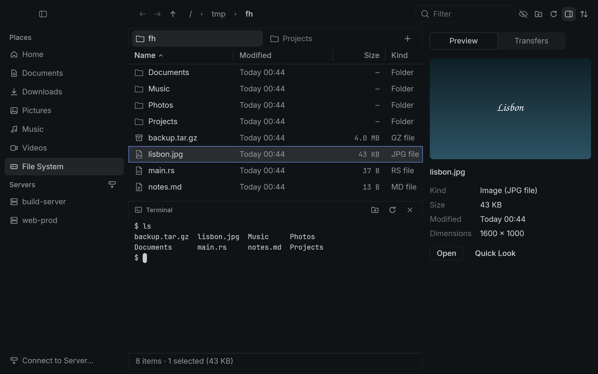

# files

A native Linux file explorer built with [Rune](https://github.com/anomalyco/rune), Anomaly's GPU-rendered Rust UI framework. It browses local folders, archives and SSH servers in tabs, copies between them with `scp`, previews files, has a built-in terminal, and stands in for Nautilus as the desktop's file manager (made for Omarchy, works on any Linux desktop).



## Features

- **Tabs**: Ctrl+N opens a tab, Ctrl+Enter opens the selected folders in tabs, Ctrl+W closes one, Ctrl+Shift+T reopens it, and Ctrl+Tab, Ctrl+Page Up/Down and Alt+1…9 move between them. Tabs reorder by drag and close with a middle click.
- **Terminal panel**: Ctrl+T opens a terminal under the files, VS Code style, in the folder shown (on a server, an `ssh` session in that folder over the shared connection). Ctrl+T from the terminal hides it; the header's buttons `cd` it to the current folder or start a fresh shell; its top edge drags to resize. It's Alacritty's terminal emulator (`alacritty_terminal`) drawn by Rune: 256 and true colours, the alternate screen (vim, less, htop), scrollback (Shift+Page Up/Down, the wheel), bracketed paste (Ctrl+Shift+V).
- **Path bar**: Ctrl+L (or a click beside the breadcrumbs, or typing `/` or `~`) to type a location, with completion as you type: folders on this machine or on the server shown, and server names. ↑ ↓ pick, Tab completes, Enter goes.
- **The desktop's file manager**: `install.sh` makes it the default for folders (`xdg-open`, "Open folder" everywhere) and the `org.freedesktop.FileManager1` D-Bus service ("Show in folder" in browsers, editors and download lists). It runs as one instance: another launch, an `xdg-open` or a D-Bus call opens a tab in the running window. Copying local files puts them on the clipboard as files (other apps paste them), and pasting files another app copied copies or uploads them here. The window's title names the folder shown.
- **Omarchy**: colours follow Omarchy's current theme (and change with it), monospace text uses the system's monospace font (Omarchy's Nerd Font), and files whose default app runs in a terminal (nvim, helix) open in one through `xdg-terminal-exec`.
- **Local browsing**: sidebar places (your XDG folders and `/`), breadcrumbs or a typed path (Ctrl+L), back/forward/up, a sortable table (name, modified, size, kind) with resizable columns, multi-select, a filter box, and hidden files on Ctrl+H.
- **SSH servers**: every `Host` in `~/.ssh/config` (and files it `Include`s) appears under Servers. Connect to anything else with Ctrl+K: `user@host`, `host:2222`, `user@host:/path`, `ssh://user@host:port/path`, with an optional password or private key file (such as an AWS `.pem`).
- **scp transfers**: copy (Ctrl+C) or cut (Ctrl+X) on one machine and paste (Ctrl+V) on another. Local → server uploads, server → local downloads, and server → other server goes through a private staging folder on this machine. Each item is its own job in the transfers pane, with cancel. At most 4 run at once, which stays under OpenSSH's 10-session-per-connection limit.
- **File operations**, local or remote: new folder, rename (F2), delete (local files go to the Trash through `gio trash`; Shift+Delete and remote deletes ask first), copy within a machine (`cp -a`), move (`mv`), and a Replace / Keep Both / Skip prompt on name conflicts.
- **Open**: double-click or Enter opens folders, and opens files in their default app (terminal apps in a terminal). Remote files are downloaded to `~/.cache/files/open/` first.
- **Archives as folders**: zip, tar (gz, bz2, xz, zst, lz4), 7z, rar, iso, deb, rpm, jar, apk and more open like folders, read-only, through `bsdtar` (libarchive). Copying something out extracts just that member; opening a file extracts it to the cache and opens it; an archive inside an archive opens too. Archives on a server download once (over scp) and are read locally. Ctrl+E extracts the selected archives into folders beside them, on a server with whichever of `bsdtar`, `tar` or `unzip` it has.
- **Previews**: Alt+P opens a preview pane beside the list, and Space opens a large Quick Look (↑ ↓ step through the folder; Space or Escape closes). Previews cover images (PNG, JPEG and SVG directly; WebP, GIF, HEIC, AVIF, TIFF, BMP, PSD and more through ImageMagick), video (a frame through ffmpegthumbnailer, with duration, resolution and codec), audio (cover art and tags through ffmpeg/ffprobe), PDF (the first page through pdftoppm, with page count), Markdown (rendered), text and code (syntax-coloured in 80 languages), archives (their contents) and folders (what they hold). Files on a server under 25 MB download to the cache for their preview; archive members are extracted. Previews are made off the UI thread and thumbnails are cached.
- **Caching**: remote files opened before reopen without scp when the server's copy has the same size and modification time (`scp -p` keeps the time), and download again when it changed. Folders visited recently show their last listing at once while a fresh one loads. Downloads and extractions live in `~/.cache/files` and are trimmed to 2 GB, least recently used first, at each launch ("Clear Download Cache" in the background menu empties them). Each server keeps one SSH connection open for 5 minutes, so browsing doesn't repeat the login.
- **Swipe navigation**: a two-finger trackpad swipe right goes back and left goes forward, as in a browser, with an arrow that fills once letting go will navigate. Vertical scrolling and mouse wheels are untouched.
- **Also**: Download to Downloads, Upload Files… (the desktop file chooser), Copy Path, Open Terminal Here (a local shell, or `ssh -t` into the remote folder), and dropping files onto the window to copy or upload them (X11 only; see Limitations).

## How the SSH side works

It drives the system OpenSSH client, so your config, keys, agent, `ProxyJump` and `known_hosts` all apply as they do in a terminal.

- **One connection per server.** Every `ssh`/`scp` call shares a multiplexed master (`ControlMaster=auto`, `ControlPersist=300`, socket in `$XDG_RUNTIME_DIR`), so only the first listing pays for the handshake. The ✕ on a connected server closes it.
- **Remote work is a POSIX script piped to `sh -s`**, with every path single-quoted. The remote login shell (bash, zsh, fish) never parses it. Listings use GNU `find -printf`, with a plain `sh` loop as a fallback for BSD and BusyBox hosts.
- **Host keys.** An unknown host opens a dialog with its SHA256 fingerprint (`ssh-keyscan`, resolved through `ssh -G`). Only "Trust and Connect" adds it, via `StrictHostKeyChecking=accept-new`. A *changed* key is refused and never offered for acceptance.
- **Passwords** go to ssh through `SSH_ASKPASS`, which is this same binary in askpass mode. They never appear on a command line and are never saved. Servers you connect to by address are remembered in `~/.config/files/servers`, without passwords.

## Build and run

Needs the Rust toolchain in `rust-toolchain.toml` (rustup installs it on first build), `libxkbcommon` and `wayland` (`pacman -S libxkbcommon wayland`), plus `openssh` and `libarchive` (for `bsdtar`, to view archives) at runtime. Previews use `imagemagick`, `ffmpeg`, `ffmpegthumbnailer` and `poppler` when installed; without one, that kind of file shows no preview.

```sh
./install.sh      # build, install to ~/.local/bin, make it the default file manager
./uninstall.sh    # remove it, and give folders back to Nautilus
```

Or run it from the build:

```sh
cargo build --release
target/release/files                         # your home folder
target/release/files ~/Projects /etc         # each location in a tab
target/release/files user@host:/var/www      # straight to a server
target/release/files --new-instance          # a separate window, not a tab in the running one
```

On Omarchy, point the file manager keys at it in `~/.config/hypr/bindings.lua`:

```lua
o.rebind("SUPER + SHIFT + F", "File manager", { launch = "files" })
o.rebind("SUPER + ALT + SHIFT + F", "File manager (cwd)", 'uwsm-app -- files "$(omarchy-cmd-terminal-cwd)"')
```

`FILES_SSH_CONFIG=/path/to/config` makes every ssh/scp call use that config (`-F`) and lists its hosts in the sidebar in place of `~/.ssh/config`'s.

## Keys

F1 (or Ctrl+/) shows all of these in the app.

**Navigate**

| Key | Action |
| --- | --- |
| Enter, Ctrl+O, Alt+↓ | Open (archives open as folders) |
| Backspace, Alt+↑ | Enclosing folder |
| Alt+← / Alt+→ | Back / Forward |
| Mouse back / forward | Back / Forward |
| Two-finger swipe right / left | Back / Forward (trackpad) |
| Alt+Home | Home folder |
| Ctrl+L, Alt+D, F6 | Type a location |
| / or ~ | Type a location starting there |
| F5, Ctrl+R | Reload |

**Select**

| Key | Action |
| --- | --- |
| ↑ ↓, Home, End, Page Up/Down | Move |
| Shift + those, Shift+click | Extend the selection |
| Ctrl+click | Add or remove one |
| Ctrl+A | Select all |
| Type a name | Jump to it |
| Ctrl+F | Filter this folder |
| Escape | Clear the filter, clipboard or selection |

**Files**

| Key | Action |
| --- | --- |
| Ctrl+C / Ctrl+X / Ctrl+V | Copy / Cut / Paste (scp between machines) |
| Ctrl+D | Duplicate |
| Ctrl+E | Extract the selected archives here |
| F2 | Rename |
| Delete | Move to Trash (delete on a server) |
| Shift+Delete | Delete permanently |
| Ctrl+Shift+N | New folder |
| Ctrl+Alt+N | New empty file |
| Ctrl+Shift+C | Copy path |
| Alt+Enter, Ctrl+I | Properties |
| Space | Quick Look (↑ ↓ step through files, Space closes) |
| Menu, Shift+F10 | Context menu |

**Servers**

| Key | Action |
| --- | --- |
| Ctrl+K | Connect to a server |
| Ctrl+Shift+D | Download (or extract from an archive) to Downloads |
| Ctrl+U | Upload files here |
| Ctrl+Shift+K | Disconnect from this server |

**View**

| Key | Action |
| --- | --- |
| Ctrl+= / Ctrl+- / Ctrl+0 | Zoom in / out / reset |
| Ctrl+scroll | Zoom |
| Ctrl+H, Alt+. | Show hidden files |
| Ctrl+1 / 2 / 3 / 4 | Sort by name / modified / size / kind (again flips) |
| Ctrl+B, F9 | Sidebar |
| Alt+P | Preview pane |
| Ctrl+J | Transfers |

**Tabs**

| Key | Action |
| --- | --- |
| Ctrl+N | New tab here |
| Ctrl+Enter | Open the selected folders in new tabs |
| Ctrl+W | Close the tab (the last one closes the window) |
| Ctrl+Shift+T | Reopen the last closed tab |
| Ctrl+Tab / Ctrl+Shift+Tab | Next / previous tab |
| Ctrl+Page Down / Up | Next / previous tab |
| Alt+1 … Alt+8, Alt+9 | Go to tab 1 … 8, the last tab |
| Middle-click a tab | Close it |

**Window**

| Key | Action |
| --- | --- |
| Ctrl+T | Terminal panel: open and focus; from it, hide |
| Ctrl+Shift+V (in the terminal) | Paste |
| Shift+Page Up / Down (in the terminal) | Scroll back |
| F4, Ctrl+Alt+T | Terminal window here |
| Ctrl+Q | Quit |
| F1, Ctrl+/ | Keyboard shortcuts |

## Layout

| File | Holds |
| --- | --- |
| `src/model.rs` | `Location` (a local path or `host` + path), entries, sorting, formatting |
| `src/local.rs` | Local listing and XDG folders |
| `src/ssh.rs` | `Target` parsing, ssh/scp commands, remote listing, ssh config hosts, error classification |
| `src/preview.rs` | Making previews on a worker: thumbnails, text, tags, archive and folder summaries |
| `src/term.rs` | The terminal: a PTY and `alacritty_terminal`'s emulator, rows of coloured text, key encoding |
| `src/ipc.rs` | Single instance and `org.freedesktop.FileManager1` over D-Bus |
| `src/theme.rs` | Omarchy's theme colours, watched for changes |
| `src/open.rs` | Opening files in their default app, terminal apps in a terminal |
| `src/archive.rs` | Archive listing (`bsdtar -tv`) into a folder tree, and member extraction |
| `src/ops.rs` | Copy, move, delete, rename and mkdir as job steps: scripts on one machine, `scp` between machines |
| `src/jobs.rs` | The job runner: steps on a thread, cancel by process group, results through the window's waker |
| `src/app.rs` | App state and every action |
| `src/keys.rs` | Every keyboard shortcut, and the list the F1 sheet shows |
| `src/view/` | Sidebar, toolbar, table, transfers pane, dialogs |

## Testing

```sh
cargo test
```

The SSH round trip (`src/remote_tests.rs`) runs against a real sshd when `FILES_TEST_SSH_CONFIG` names an ssh config whose `testhost` (and `testhost-alias`, the same server under another name) log in with a key. It is skipped otherwise. A throwaway server needs no root:

```sh
D=/tmp/files-sshd; mkdir -p $D && cd $D
ssh-keygen -q -t ed25519 -N '' -f host_key; ssh-keygen -q -t ed25519 -N '' -f client_key; cp client_key.pub authorized_keys
cat > sshd_config <<EOF
Port 2299
ListenAddress 127.0.0.1
HostKey $D/host_key
PidFile $D/sshd.pid
AuthorizedKeysFile $D/authorized_keys
PasswordAuthentication no
UsePAM no
StrictModes no
Subsystem sftp /usr/lib/ssh/sftp-server
EOF
for h in testhost testhost-alias; do printf 'Host %s\n  HostName %s\n  Port 2299\n  IdentityFile %s/client_key\n  IdentitiesOnly yes\n  UserKnownHostsFile %s/known_hosts\n' \
  $h $([ $h = testhost ] && echo 127.0.0.1 || echo localhost) $D $D; done > client_config
/usr/bin/sshd -D -e -f $D/sshd_config &
FILES_TEST_SSH_CONFIG=$D/client_config cargo test
```

Rune apps also run headless, which is how the UI was checked: `files DIR --snap out.png --size 1100x680`, `--script events.json --at 3.0` to click and type, and `--scene transfers|connect|hidden`.

## Limitations

- Transfers show running/done/failed but not a percentage: `scp` prints progress only to a terminal.
- Archives are read-only: there's no adding to or creating archives.
- It isn't a file *chooser*: apps' Open and Save dialogs still come from the XDG desktop portal (GTK's or GNOME's), which would need a separate portal backend.
- The terminal panel has no mouse text selection yet; copy with the program's own means (tmux, vim) or from the scrollback in a terminal window (F4).
- A Nautilus already running as a background D-Bus service keeps `org.freedesktop.FileManager1` until it exits (or the next login), since it doesn't allow its name to be taken over.
- The swipe needs trackpad deltas marked precise; whether a given Linux touchpad driver and compositor deliver them that way is up to them. Mouse wheels never trigger it.
- A remote file opened in an app is a downloaded copy; saving it doesn't upload it back.
- Dropping files in from other apps works on X11, not Wayland (winit 0.30 reports no file drags there). Dragging files out to other apps isn't supported on Linux yet.
- Password logins answer one password prompt. Keyboard-interactive two-factor prompts aren't supported; use keys or the agent.
- Two aliases for the same host, port and user share one connection, so the second skips its own host-key check. The server was already verified by the first.
